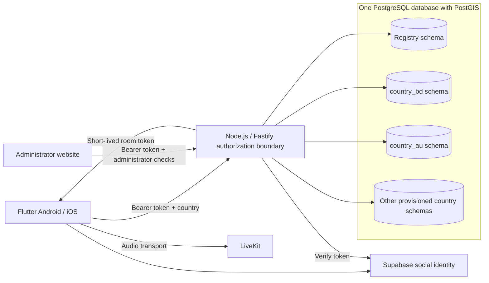

# Architecture and decisions

An initiative by Bindubashini Boys’ 2015 & Friends.

## Service and database boundaries



The client never chooses its own role or enforcement status. Every protected route checks server-side identity, role and object membership. A country header scopes a request but grants no authority. Regular members use the mobile app; administrators have native and browser interfaces.

## Why this stack

The backend uses JavaScript on Node.js 24 with Fastify. JSON Schema validation rejects unknown fields and invalid body types; security headers, explicit origins, bounded bodies and sanitized errors protect the HTTP boundary. `pg` provides parameterized queries and explicit database transactions without a second persistence abstraction. Sharp handles bounded image decoding and metadata stripping. Supabase supplies social identity, while LiveKit supplies audio transport; both require real deployment configuration.

PostgreSQL supplies transactional constraints, concurrency control, roles and durable shared rate counters. PostGIS supplies a generated geography column and GiST index for radius searches in meters. Search still returns fixed coarse areas and distance bands rather than private points. No Redis, MongoDB, NestJS or Prisma service is required by this implementation.

## Country schemas and travel

The user approved **one PostgreSQL database with isolated country schemas for the local implementation**. Country profiles, conversations, messages, reports/evidence, requests, photos and inbox/outbox rows are in schemas such as `country_bd` and `country_au`. The `registry` schema coordinates identity, active country, availability/cooldown, blocks, bans, deletion, shared match reservations and private donation history/confirmation receipts.

The schemas provide logical country organization, not separate databases or geographic residency. The API role can access the schemas required for its authorized workflows; schema naming itself does not authorize a caller. SQL identifiers come only from a fixed ISO allowlist, and values are bound parameters. Production exposes explicitly enabled, provisioned countries. A local demo may provision the full ISO catalog without claiming any worldwide hosting.

Foreground automatic location uses explicit consent; manual selection remains authoritative until the member changes modes. A single transaction moves the current profile and photo, removes the old discovery profile, changes registry routing, and closes invalid matches/calls. Messages and reports stay in their original schema. Cooldowns, bans, preferences, donation history and reminders survive travel. Historical owner report/event routes can select their stored country without moving the account. See [location behavior](LOCATION-AND-ACCESS.md).

Independent country databases or geographic residency would require regional deployment, authenticated registry communication and recoverable cross-region operations. They cannot be substituted for schemas while claiming the same single-transaction guarantees. That production design remains separate work.

## Transactions and concurrency

Each domain transaction runs on one pooled connection at `SERIALIZABLE` isolation. Bounded retries handle PostgreSQL serialization/deadlock failures. Retried callbacks contain database work only; network push/media operations occur after persistent state is recorded. A source/destination profile move, global safety update or report resolution cannot partially commit.

The database enforces one donation per request and one manual intent per confirming actor/key. A matched pair has unique participant reservations keyed by account ID, preventing simultaneous matches even when one account acts as donor in one request and seeker in another. Unique report-review events and outbox keys complement row locks and transaction isolation. Audit rows cannot be updated or deleted by the runtime role.

The migration identity owns application schemas. The runtime identity has CRUD/sequence access but no schema creation or audit mutation privileges. Database/extension provisioning belongs to an administrator; migration credentials are not needed by the API process. Test reset is restricted to a separate database ending in `_test` and uses migration credentials. The interactive database is never a test fixture.

## Availability and donation records

```text
discoverable = complete profile
               AND active country matches
               AND donor voluntarily available
               AND cooldown elapsed
               AND account active
               AND no blocking relationship
```

Three months means calendar months with month-end clamping. New donation records validate the local date against a bounded UTC offset and save an absolute UTC deadline at the resulting local midnight. The recorded offset is fixed, not a prediction of future daylight-saving changes. New or backdated logs cannot shorten an existing pause. Availability is derived at read time; no scheduled task is needed to return an otherwise consenting donor. This application pause and informational BMI are not clinical eligibility decisions.

Closing a request creates a shared confirmation reminder, not a donation. Either accepted participant can record the donor’s actual date and place. The first Yes updates the actual donor, history and receipt together. A seeker's response contains only their own profile. Each person's No dismisses only that person's reminder. Full history stays donor-only; matched request outcomes expose a limited receipt. See [donation behavior](DONATIONS.md).

## Communication, safety and deletion

Conversation reads require membership. New contact/messages/calls also check bans, country and blocks. Private photos require the owner or a currently accepted counterpart. Submitted reports and evidence remain accessible to their reporter and authorized moderators; accused administrators cannot review their own allegations. Review status, any global ban, immutable audit, reporter event and outbox entries commit together. Fixed public explanations never copy internal notes.

Donation and report notifications use a durable inbox/outbox and eligibility checks at delivery. Push previews are generic. Delivery is at least once; clients deduplicate `(country,event_id)`. Messages and call invitations currently use foreground polling; production background chat/VoIP remains separate work. Media cleanup and deletion have durable retry queues, while the global tombstone immediately revokes deleted-account access.

The Node.js one-time importer reads legacy SQLite files without modifying them, creates backups, and imports into an empty PostgreSQL database transactionally. SQLite is not an application runtime database. Reusing a populated target is rejected rather than overwriting records. Raw database backups and personal device evidence remain outside Git.

## Operational limits

The local setup is a single PostgreSQL service with loopback-only published ports, not a highly available multi-region deployment. PostgreSQL-backed coordination supports shared state across API workers, but production capacity, backup restoration, failover, connection limits and worker behavior still require deployment testing. Exact location filtering can permit inference despite coarse display and rate limits.

TLS, encryption of storage/backups, secret management and administrator MFA are deployment responsibilities. Application fields are not individually encrypted, messages are not end-to-end encrypted, and account bans do not prove a unique human across different social identities. Operational logs must omit tokens, messages, exact coordinates, measurements and evidence. The project makes no claim of automatic clinical/regulatory compliance or completed Apple-device verification.
