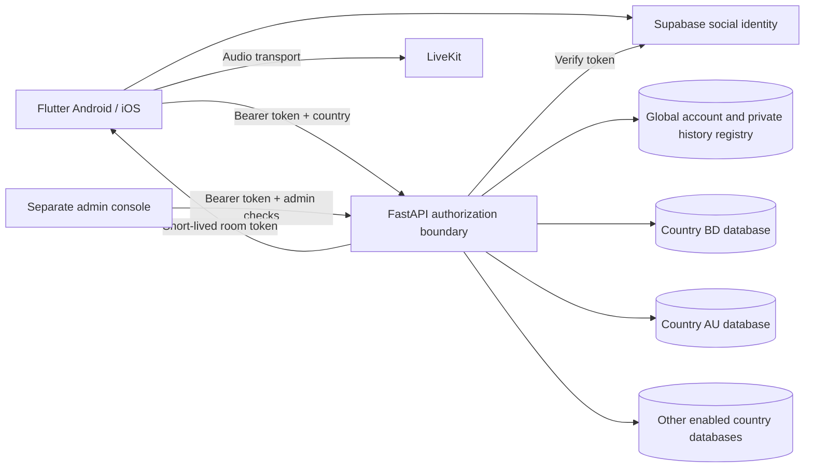

# Architecture and decisions

## Boundaries



The client never chooses its own role or determines enforcement. Server-side checks apply to each protected route, including admin, messages, calls, reports, export, and deletion. A country header scopes a request but is not proof of authority.

## Why this stack

Flutter is already installed in the development environment and supports the connected Pixel plus a shared iOS codebase. Material controls provide accessibility and touch behavior without a custom component framework. FastAPI supplies typed boundary validation and an inspectable API. SQLite gives a runnable local system with separate database files without requiring a cloud account or database service. This is a single-service, single-host implementation; do not scale by adding independent replicas over local files.

Supabase handles the provider OAuth exchange and identity lifecycle instead of implementing passwords or OAuth ourselves. The server validates access tokens with the configured identity service, restricts provider identities, and assigns admin access from server configuration. LiveKit handles audio transport instead of building a WebRTC relay. Both are integration dependencies requiring configuration and separate real-service verification.

## Country storage and travel

Each enabled ISO country has a separate SQLite database containing local profiles, conversations, messages, reports, and calls. A shared registry coordinates identity, active country, voluntary availability, cooldown, deletion, and permanent bans. It also contains private owner donation history and completed-request confirmation receipts, so travel preserves these records. This health-related history makes the global data boundary broader than minimal enforcement metadata. Duplicating enforcement independently would allow travel to reset a cooldown or evade moderation.

Automatic foreground location uses an explicit initial consent explaining country updates during travel. Native reverse geocoding resolves country and area together; manual mode geocodes a selected area and checks its country. Only the active country exposes the donor for discovery; previous local profile discovery is removed atomically. Conversation history is not automatically copied between country databases. Travelers must understand that old conversations may be unavailable until returning to that region. Global safety state remains in force. See `LOCATION-AND-ACCESS.md` for failure and override behavior.

Separate files are logical separation, not physical data residency. A worldwide production rollout needs an approved country routing map, a regional host and backups for each deployed country, selected authentication/media regions, and an explicit policy for the shared registry. Never claim all countries are hosted locally because their filenames differ.

## Availability invariant

```text
discoverable = complete profile
               AND active country matches
               AND donor voluntarily available
               AND cooldown elapsed
               AND account active
               AND no blocking relationship
```

Three months means calendar months with month-end clamping, not 90 days. New donation logs validate the local calendar date using a bounded UTC offset and save a precise UTC deadline at the resulting local midnight. The recorded offset is fixed, not an IANA timezone/DST prediction. Legacy date-only records retain their UTC-midnight interpretation. The server derives current availability from time; no scheduled job is needed merely to return a consenting donor to discovery. Recording an older donation cannot shorten an existing pause. Local blood-service rules can require a longer delay or additional assessment. BMI is not an eligibility decision. For example, Australian Lifeblood describes a 12-week whole-blood interval; this application's requested three-calendar-month pause is its own conservative minimum, not a universal medical rule. [Lifeblood whole-blood guidance](https://www.lifeblood.com.au/donors/blood-plasma-platelets/learn/blood).

## Actual donations and completion reminders

Closing coordination and recording an actual donation have separate meanings. Completion creates a global receipt carrying both matched identities and independent dismissal flags. Either participant can confirm, but every linked save targets the accepted donor. `BEGIN IMMEDIATE` and a unique request reference make simultaneous Yes submissions produce one history record and one donor cooldown update. The record retains the confirming actor and role. The response returns the caller's own profile, so a seeker never receives the donor's private measurements.

An actor/idempotency-key index protects manual retries. Reusing a committed key with changed details returns 409. Receipt recorded state, donation history and non-shortening donor cooldown commit together; a No updates only that participant's dismissed flag. Full history stays donor-only, with a limited matched-request outcome available to its pair. Confirmation checks refresh the caller profile so another device's confirmation updates the donor's displayed availability. The compact Home control and detailed Profile/settings card derive countdown from the same UTC deadline; no second availability state or scheduled expiry job is required. See [donation workflow](DONATIONS.md).

## Privacy and abuse resistance

No phone-number field exists. Donor list responses are allowlisted summaries rather than serialized profile objects. Precise location is retained only to calculate distances. Rounded distance bands reduce disclosure, but do not make repeated location searches anonymous; operational anti-scraping controls and location-change limits remain important.

Conversation membership authorizes history and reporting; message/call writes additionally enforce active relationships. Both matched request participants can report, including after closure or a block. Report image attachments are validated, sanitized, bounded and stored in the report's regional database; authenticated no-store reporter/admin byte endpoints expose them without public URLs. Duplicate image retries are deduplicated by content digest. Report evidence is limited and reviewed by admins; messaging is not end-to-end encrypted in this build. Moderation requires a review note and records an audit entry. A confirmed money-request report bans the identity globally. There is no reliable claim that one human can never create another social account; that requires an additional identity-verification policy that would increase privacy cost.

## Deliberate limits

* SQLite and in-process controls target one local service process. Before multiple workers/hosts, move coordination, rate limits, and country storage to shared infrastructure with transaction guarantees.
* Foreground polling provides message and call updates while the app is open. Donation request push uses a durable encrypted UnifiedPush/APNs outbox. Android background calling and iOS CallKit/VoIP push remain separate production work.
* Discovery maps display coarse server-defined areas, never individual donor coordinates. Exact meeting destinations are shared separately after acceptance. No advertising SDK, contact upload, payment flow, automated clinical diagnosis, or blood compatibility recommendation is included.
* Production metrics must omit tokens, message bodies, exact locations, and private measurements. Alerts should report operational outcomes, not personal records.
